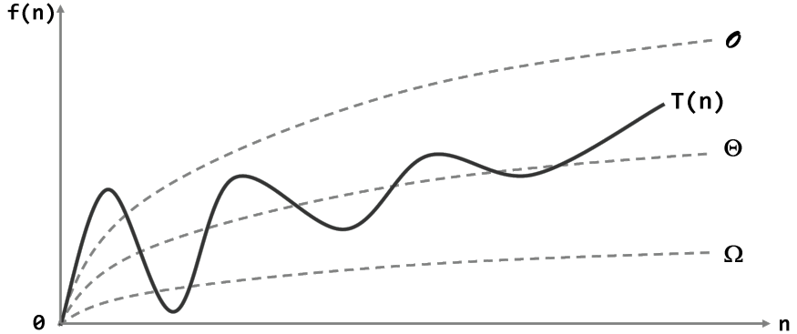

# 绪论

## 1.1 计算机与计算

计算机科学的核心在于研究计算方法与过程的规律，而不仅仅是作为计算工具的计算机本身，因此，E.Dijkstra 更倾向将这门学科称为计算科学。

### 1.1.3 起泡排序

从前向后依次检查每一对相邻元素，一旦发现逆序即交换二者的位置，排序过程中，所有元素朝各自最终位置亦步亦趋的移动过程，犹如起泡在绥中的上下沉浮，起泡排序（bubblesort）算法因此得名。

### 1.1.4 算法

算法是指基于特定的计算模型，旨在解决某一信息问题而设计的一个指令序列。

- 可行性：算法应可描述为由若干语义明确的基本操作组成的指令序列
- 有穷性：任意算法都应在执行有限次基本操作之后终止并给出输出
- 正确性：给出的输出应符合问题本身在事先确定的条件
- 鲁棒性：实用的算法应能处理各种极端的输入实例
- 重用性：算法的总体框架能便捷地推广至其它场合

证明算法有穷性和正确性的一个重要技巧，就是从适当的角度审视整个计算过程，并找出其所具有的某种不变性和单调性。
其中单调性通常是指，问题的有效规模会随着算法的推进不断递减。

### 1.1.5 算法效率

- 可计算性：就大量的应用问题而言，根本不可能设计出必然终止的算法，它们属于不可解问题
- 难解性：很多算法即便满足有穷性，但在终止之前所花费的时间成本却太高，大量问题的最低求解时间成本，都远远超出目前系统所能提供的计算能力

计算效率：我们非“不可解和难解”的关注一般性的问题，从时间和空间等方面度量算法的计算成本。

数据结构这一学科正是以“数据”这一信息的表现形式为研究对象，旨在建立支持高效算法的数据信息处理策略、技巧与方法。

我们要学习的是**对算法设计的技巧以及相应数据结构的特性了然于心**。

## 1.2 复杂度度量

### 1.2.1 时间复杂度

特定算法处理规模为 n 的问题，所需的时间记作 T(n)。

规模相同的输入通常都有多个，算法对其处理所需的时间往往不尽相同。从保守估计的角度出发，
在规模为 n 的所有输入中，选择执行时间最长者作为 T(n)，并以 T(n) 度量该算法的时间复杂度。

### 1.2.2 渐进复杂度

在评价算法运行效率时，我们往往可以忽略其所处理小规模问题时的能力差异，转而关注其处理更大规模问题时的表现。
这种着眼长远、更为注重时间复杂度的的总体变化趋势和增长速度的策略与方法，即所谓的渐进分析（asymptotic analysis）。

#### 大O记号

我们关注 T(n) 的渐进上界，引入所谓“大 O 记号”

定义是，存在正的常数 c 和函数 f(n)，对于任何的 n，都有 $T(n) \le c*f(n)$，当 n 足够大之后， f(n) 给出了 T(n) 增长速度的一个渐进上界。记作 $T(n) = O(f(n))$。

这一定义可以导出两个性质

- 对于任一常数 c>0，有 $O(f(n)) = O(c*f(n))$，意味着，在大 O 记号的意义下，函数各项正的常系数可以忽略并等同于1
- 对任意常数 a>b>0，有 $O(n^a + n^b) = O(n^a)$，意味着，多项式中的低次项均可忽略，只需保留最高次项

#### 大Ω记号

为了对算法的复杂度最好情况做出估计，需要借助另一个记号 Ω

定义是，存在正的常数 c 和函数 g(n)，对于任何的 n，都有 $T(n) \ge c*g(n)$，当 n 足够大之后， g(n) 给出了 T(n) 的一个渐进下界，记作
$T(n) = Ω(f(n))$，

大Ω记号是对算法执行效率的乐观估计，对于规模为 n 的任意输入，算法的执行时间都不低于Ω(g(n))

#### 大θ记号

从渐进的趋势看，T(n) 介于 Ω(g(n)) 与 O(f(n)) 之间，若恰巧出现 g(n) = f(n)，则可以用另一种 θ 记号，θ 记号可以对算法时间复杂度做出定量的界定。大θ记号是对算法复杂度的准确估计

### 1.2.3 空间复杂度

针对时间复杂度引入的几种渐进记号，也适用于队空间复杂度的度量，其原理及方法基本相同。

空间复杂度通常并不计入原始输入本身所占用的空间。

## 1.3 复杂度分析

大O记号是最基本的，也是最常用的。从渐进分析的角度，大O记号将算法的复杂度由低到高分为若干层次级别。

- 常数 O(1)
- 对数 O(logn)
- 线性 O(n)
- 多项式 O(polynomial(n)) 
- 指数 $O(2^n)$

通常认为，指数复杂度算法无法真正应用于实际问题，他们不是有效算法，甚至不能称作算法。相应地，不存在多项式复杂度算法的问题，也称作难解的问题。

## 1.4 递归

### 1.4.1 线性递归

每一递归实例对自身的调用至多一次，此类递归模式因而称作“线性递归”（linear recursion），它也是递归的最基本形式

#### 减而治之

线性递归的模式，往往对应于所谓减而治之（decrease-and-conquer）的算法策略：递归每深入一层，待求解问题的规模都缩减一个常数，直至最终蜕化为平凡的小（简单）问题。

### 1.4.2 递归分析

递归算法的复杂度分析主要有两种方法

#### 递归跟踪

算法的每一个递归实例都表示为一个方框，其中注明了该实例调用的参数，若实例 M 调用实例 N，则在 M 与 N 对应的方框之间添加一条有向联线。

- 整个算法所需要的计算时间，应该等于所有递归实例的创建、执行、销毁所需的总和。
    - 其中实例的创建和销毁由操作系统负责完成，其对应的时间成本通常可以近似为常数，不会超过递归实例中实质计算步骤所需的时间成本，故往往均予忽略
    - 我们只需统计各递归实例中非递归调用部分所需的时间
- 时间应为每个递归实例所需时间 * 递归实例的个数

#### 递推方程

递推方程法是分析递归算法复杂度的一种数学方法，核心思路是把算法的执行时间用数学公式表示出来，通过解这个公式得到复杂度。

适合复杂递归：比如二分递归（如归并排序）、多分支递归（如斐波那契），递归跟踪法画起来太复杂，递推方程更简洁。

数学严谨性：直接得到复杂度的表达式（如O(n)、O(logn)），避免图形化跟踪的误差。

### 1.4.3 递归模式

#### 多递归基

为保证有穷性，递归算法都必须设置递归基，且确保总能执行到。

针对每一类可能出现的平凡情况，都需要设置对应的递归基，故同一算法的递归基肯能不止一个。

#### 实现递归

在设计递归基时，往往需要从多个角度反复尝试，方能确定对问题的输入及其规模的最佳划分方式。

有时，还可能需要从不同角度重新定义和描述原问题，使得经分析所得的子问题与原问题具有相同的语义形式。

#### 多向递归

不仅递归基可能有多个，递归调用也可能有多种可供选择的分支。

### 1.4.4 递归消除

递归的思想可使我们从宏观上理解和把握应用问题的实质，容易写出简洁紧凑的算法，然而，其背后也隐含着资源消耗的代价。

递归算法所消耗的空间量主要取决于递归深度，故较同一算法的迭代版本，递归版本往往消耗更多空间，并进而影响实际的运行速度。对运行速度要求极高、存储空间需要精打细算的场景，往往需要将递归算法改写成等价的非递归版本。

一般的转换思路是利用栈结构模拟操作系统的工作过程。

#### 为递归及其消除

在线性递归算法中，若递归调用在递归实例中恰好以最后一步操作的形式出现，则称作尾递归，尾递归可以简捷地转换为等效的迭代版本。

- 一种方法是，在算法起始处添加一个跳转标记，在尾递归语句调用替换为一条指向标记的跳转语句（goto）。
- 或者将标记于 if 判断综合考查，并代之以一条逻辑条件等价的 while 语句。

递归语句出现在最后一行并不见得就是尾递归，只有当该算法任一实例都终止于这一递归调用时，才属于尾递归。

### 1.4.5 二分递归

#### 分而治之

面对输入规模庞大的应用问题，将其分解为若干规模更小的子问题，再通过递归机制分别求解。这种分解持续进行，直到子问题规模缩减至平凡情况。这就是所谓的分而治之（divide-and-conquer）策略。既然每一递归实例都可能做多次递归，故称作“多路递归”，通常将原问题一分为二，故称作“二分递归”。

#### 效率

此类算法的计算消耗主要来自两个方面，首先是子问题划分，即把原问题分解为形式相同、规模更小的两个子问题。其次是子解答合并，即由递归所得子问题的解，得到原问题的整体解。

需保证子问题之间相互独立，各子问题可独立求解，而无需借助其他子问题的原始数据或中间结果。否则，或者子问题之间必须传递数据，或者子问题之间相互调用。

#### 优化策略

为了消除递归算法中重复的递归实例，一种自然而然的思路和技巧是，借助一定量的辅助空间，在各子问题求解之后，及时记录下其对应的解答，也就是所谓的指标（tabulation）或记忆（memoiztion）策略。

也可以从递归基出发，自底向上递推地得出各子问题的解，直至最终原问题的解，即所谓的动态规划（dynamic programming）策略。

#### 动态规划

动态规划是一种算法设计范式/思想，用于解决具有以下特征的问题：

- 最优子结构​：问题的最优解包含子问题的最优解。即，全局最优能由局部最优推导。
- 重叠子问题​：在递归求解过程中，会反复遇到相同的子问题。

DP 通过系统地存储并复用子问题的解来避免重复计算，从而提高效率。
